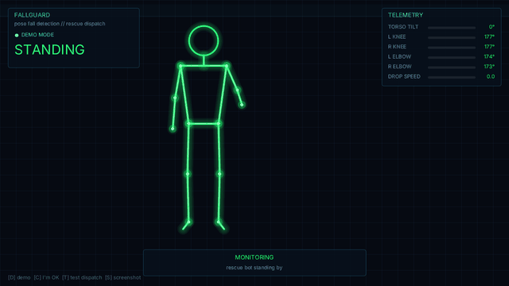

# FallGuard 🤖🚨

**A computer vision rescue bot.** A MacBook camera tracks my whole body. When I fall and stay down, a Processing sketch dispatches my Arduino tank over Bluetooth, tracks it on camera and steers it to my head.



| State | Skeleton color | What triggers it |
|---|---|---|
| Standing | 🟢 Green | Torso upright, limbs straight |
| Fall risk | 🟡 Yellow / orange | Limbs bending, torso tipping past 25°, or hips dropping fast |
| Person down | 🔴 Red | Torso more than 60° from vertical for 0.8 s |
| Rescue | 🔴 Flashing | Still down after 3 s, so the rescue tank is dispatched |

---

## How it works

```
 MacBook camera
      │
 pose_bridge.py   Python: MediaPipe Pose finds 33 body points per frame,
      │           and OpenCV finds the color marker on the tank
      │
      │  UDP :12000  body points + tank position
      │  UDP :12002  camera picture (JPEG, sent in pieces)
      ▼
 FallGuard.pde    Processing: draws the skeleton, measures joint angles and torso tilt,
      │           runs the fall state machine and the tank autopilot
      │
      │  UDP :12001  drive commands
      ▼
 pose_bridge.py  ──►  robot_link.py  ──►  Bluetooth LE (HM-10)  ──►  rescue_tank.ino on the Arduino
```

Pressing **Run** in Processing starts everything. The sketch launches the Python bridge in the background, and the bridge launches the Bluetooth link. There's no Terminal to babysit.

### Fall detection

Every frame, the sketch computes:

- **Torso tilt:** the angle between the shoulders-to-hips line and vertical (0° = upright, 90° = flat)
- **Knee and elbow angles:** how bent each limb is
- **Drop speed:** how fast the hips are moving down, in torso lengths per second

Each limb fades from green to yellow as it bends. The whole body turns yellow when the torso tips or the hips drop fast, and red once the torso has been horizontal for almost a second. After 3 seconds of red, the rescue starts. Press **C** to cancel ("I'm OK").

### Finding the tank

Put **one bright marker** on top of the tank (I use a red cup), press **M**, and click it in the camera picture. The bridge learns its color and finds it every frame. It:

- starts tracking exactly where you clicked,
- ignores anything far too big to be a marker on a small robot (doors, walls),
- won't jump to another same-colored object across the room,
- switches to a stricter color match if the marker blends into the background.

A cyan **RESCUE BOT** ring follows the tank on screen.

### Driving to you

One marker shows *where* the tank is, but not *which way it faces*. The camera only learns its direction after it moves. So the autopilot drives in a simple loop that never steers on stale information:

1. **Drive straight** a short stretch.
2. **Measure** the exact direction it just travelled. That's the bold cyan arrow.
3. **If that line passes close to your head, keep going straight.**
4. **If not, make a small turn**, about half of the error, and learn how far its turns really go. Then repeat.

Under-correcting on purpose keeps it from swinging back and forth, and measuring after every straight stretch cancels out a tank that pulls to one side (mine has loose tracks). If it stops moving, it assumes it's blocked: it backs up, turns away, drives a detour, then aims again.

The target is your **head**: the average of whatever face points the camera can see, or a point just past your shoulders if your face is hidden. It's smoothed so a flickering face can't make the target jump. During a standing test (key **T**), it drives to your feet instead.

Optional: press **B** and click a second marker of a different color at the back of the tank. With two markers it knows its direction instantly and steers continuously.

---

## Hardware

- MacBook (any Mac with a camera, macOS)
- [Keyestudio Mini Tank Robot V2 (KS0428)](https://docs.keyestudio.com/projects/KS0428/en/latest/): Arduino UNO-compatible board, L298P motor shield and HM-10 Bluetooth module
- Something bright for a marker: a red cup, a colored sticky note, or [this phone wallpaper](screenshots/tank-marker-phone.png) (green = front, blue = back)

## Software

- [Processing 4](https://processing.org/download)
- Python 3.10 to 3.12 (MediaPipe, OpenCV and bleak are installed automatically on first run)
- [Arduino IDE](https://www.arduino.cc/en/software) with **Arduino AVR Boards** installed

---

## Setup

### 1. Upload the tank code

1. **Unplug the HM-10 Bluetooth module** from the tank. Uploads fail while it's attached.
2. Plug the tank into the Mac over USB and open `rescue_tank/rescue_tank.ino` in the Arduino IDE.
3. **Tools > Board > Arduino AVR Boards > Arduino Uno**, then **Tools > Port > /dev/cu.usbserial-...**
4. Click **Upload**, then unplug USB, plug the Bluetooth module back in (VCC to 5V, GND to GND) and switch the tank on. It should sit still, waiting for commands.

**If your tracks run the wrong way:** connect, click the sketch window and press **1**, **2**, **3** and **4**. Each one spins one track for 1 second. Then set `LEFT_FLIP`, `RIGHT_FLIP` and `PWM_INVERTS` at the top of `rescue_tank.ino` to match. (On my tank the left/right pins were swapped and both tracks were reversed, so the code ships with that fix.)

### 2. Run FallGuard

1. Open `FallGuard/FallGuard.pde` in Processing and press **Run**.
2. The first run installs the Python packages (1 to 3 minutes) and downloads the pose model. macOS asks to let **Processing** use the **camera** and **Bluetooth**; allow both.
3. The bottom panel shows **"rescue tank: connected to HMSoft"** once the tank is linked. Drive it with the arrow keys to test.
4. Press **M** and click the marker on the tank.
5. Step back so your whole body is in frame (about 8 to 10 feet), then lie down, or press **T** to test.

---

## Keys

| Key | Action |
|---|---|
| Arrow keys | Drive the tank by hand (also cancels the autopilot) |
| M | Click the marker on the tank (one is enough) |
| B | Optional second marker at the back, in a different color |
| T | Test a rescue right now |
| C | Cancel the alarm ("I'm OK") |
| X | Flip the steering direction (only if the tank turns away from you) |
| 1 to 4 | Motor test: spin one track for 1 second |
| K | Switch to the next camera (if it opens your iPhone) |
| V | Camera picture on/off |
| R | Restart the camera bridge |
| D | Demo mode |
| S | Save a screenshot |

## Tuning

Thresholds sit at the top of `FallGuard.pde`: `TILT_WARN`, `TILT_DOWN`, `DISPATCH_DELAY_S`, `ARRIVE_DIST`, `ON_COURSE_DEG`, `UNDER_CORRECT` and more. Tank speeds are at the top of `rescue_tank.ino`.

## Troubleshooting

| Problem | Fix |
|---|---|
| Stays in DEMO MODE | Read the yellow `camera:` line at the bottom left; press **R** to retry |
| Opens the iPhone camera | Press **K**, or turn off Continuity Camera on the iPhone |
| "searching for the tank" | Switch the tank off and on; make sure only one FallGuard window is running |
| Tank isn't in the HM-10 list in macOS Bluetooth settings | Normal: it's Bluetooth Low Energy, so `robot_link.py` finds it by name |
| Ring locks onto the wrong thing | Press **M** and click right on the marker; avoid markers the same color as your floor or walls |
| Arrows only work sometimes | Click the sketch window first, so it has keyboard focus |
| Tank keeps getting blocked | Clear the path, charge the batteries, start it on hard floor rather than a rug edge |

## Limitations

- Your whole body needs to be in frame, and the camera needs to see the tank.
- Lying on a bed looks the same as lying on the floor. Press **C** to cancel.
- This is a learning project, not a medical or safety device.

## Built with

[Processing](https://processing.org) · [MediaPipe Pose Landmarker](https://ai.google.dev/edge/mediapipe/solutions/vision/pose_landmarker) · [OpenCV](https://opencv.org) · [bleak](https://github.com/hbldh/bleak) · Arduino

## License

MIT. See [LICENSE](LICENSE). Use it, remix it, build your own rescue bot.
